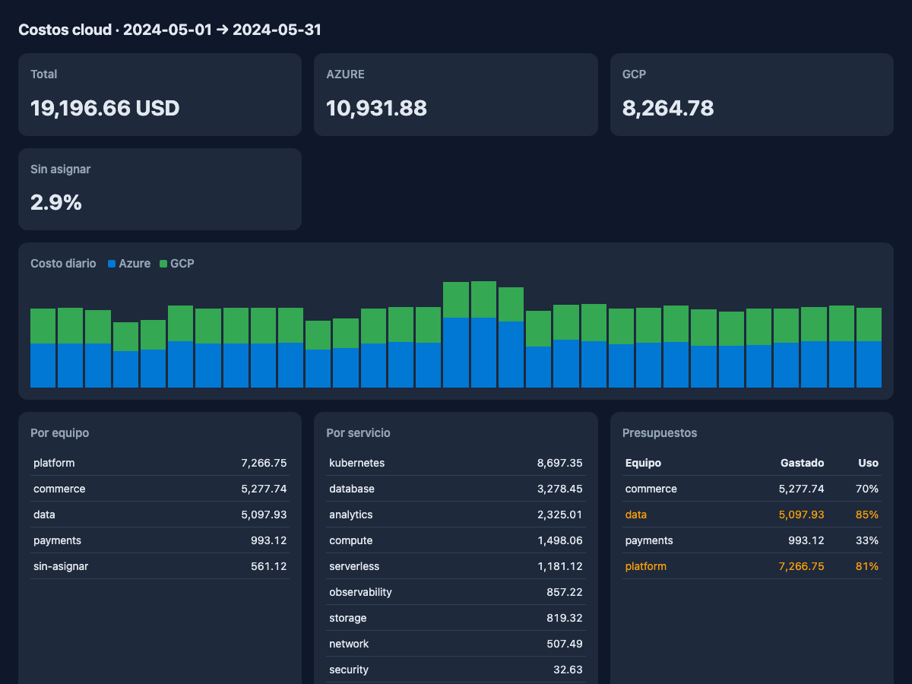
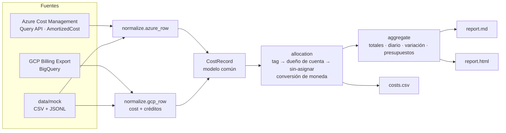

# cloud-cost-report

[](https://github.com/tomaseduar60/cloud-cost-report/actions/workflows/ci.yml)


Reporte de costos **multi-cloud (Azure + GCP)** en un solo modelo: por equipo, servicio y ambiente, con tendencia diaria, variación contra el período anterior y alertas de presupuesto.

Viene con **datos mock** que tienen el formato real de los exports, así se puede probar sin credenciales:

```bash
pip install -e .
cost-report build --from 2024-05-01 --to 2024-05-31 --out out/
```



## El problema

Cada nube reporta a su manera. Azure habla de suscripciones, *meter categories* y tags; GCP de proyectos, servicios, labels y créditos que vienen en negativo. Además los montos llegan en distintas monedas y muchos recursos no tienen tag de equipo. Así, responder "¿cuánto gastó cada equipo este mes y por qué subió?" exige juntar planillas a mano.

## Arquitectura



Decisiones clave:

- **Un solo modelo (`CostRecord`).** Los proveedores solo traducen; nada de lo que viene después sabe de Azure o GCP. Agregar AWS es escribir un normalizador.
- **El mock pasa por el mismo código.** Los datos de ejemplo usan el formato real de cada export y entran por los mismos normalizadores que los datos de producción. Si el mock funciona, el camino real también.
- **Costo amortizado en Azure y neto de créditos en GCP.** Son los números que se comparan entre sí; el costo "actual" de Azure distorsiona los meses con reservas.
- **Asignación con fallback explícito.** Primero el tag/label `team`; si no está, el dueño de la cuenta configurado; si tampoco, `sin-asignar`. Ese último bucket se muestra aparte porque es la deuda de tagging por cerrar.
- **`Decimal`, no `float`.** Los montos se suman sin errores de redondeo y se redondean a centavos solo al presentar.

## Configuración

[`config.yaml`](config.yaml):

```yaml
currency: USD
rates:
  EUR: "1.08"           # 1 EUR = 1.08 USD
account_owners:         # fallback cuando falta el tag team
  sub-data-prd: data
  shop-prd-4821: commerce
budgets:                # mensual por equipo
  platform: "9000"
  data: "6000"
alert_threshold: "0.8"  # alerta desde el 80 %
```

## Fuentes reales

| Fuente | Variable | Auth |
|---|---|---|
| `--source azure` | `AZURE_COST_SCOPE` (billing account o suscripción) | `DefaultAzureCredential`: az login, managed identity o workload identity |
| `--source gcp` | `GCP_BILLING_TABLE` (tabla del billing export) | Application Default Credentials |

```bash
pip install -e ".[azure,gcp]"
cost-report build --source azure --source gcp --from 2024-05-01 --to 2024-05-31 --out out/
```

Solo hacen falta permisos de lectura: *Cost Management Reader* en Azure y `roles/bigquery.dataViewer` + `jobUser` en GCP.

## Salidas

| Archivo | Para qué |
|---|---|
| `report.md` | Pegar en un PR, issue o canal de chat. Sin `--out` se imprime por stdout |
| `report.html` | Compartir: KPIs, barras diarias por nube, equipos, servicios y presupuestos. Un solo archivo, sin dependencias |
| `costs.csv` | Detalle normalizado para planillas, con el servicio original para auditar el mapeo |

`--fail-on-alert` sale con código `3` si algún equipo pasa el umbral, para cortar un pipeline o disparar una notificación.

## En CI

El workflow corre lint, tipos y tests con el [template reutilizable de Python](https://github.com/tomaseduar60/github-actions-templates), y además genera el reporte con datos mock: lo publica en el *job summary* y lo deja como artifact.

Para correrlo en producción, un `schedule` mensual con OIDC hacia Azure y GCP (sin secretos de larga duración) y `--fail-on-alert` alcanza.

## Datos mock

`scripts/generate_mock_data.py` genera abril y mayo con semilla fija e incluye a propósito los casos difíciles:

- recursos sin tag de equipo, unos con dueño de cuenta y otros sin dueño;
- créditos de compromiso de uso en GCP;
- una suscripción facturada en EUR;
- un pico de 3 días en Kubernetes a mitad de mayo (el típico autoscaling desbocado).

## Desarrollo

```bash
pip install -e ".[dev]"
ruff check . && ruff format --check . && mypy . && pytest --cov
```

## Licencia

[MIT](LICENSE)
